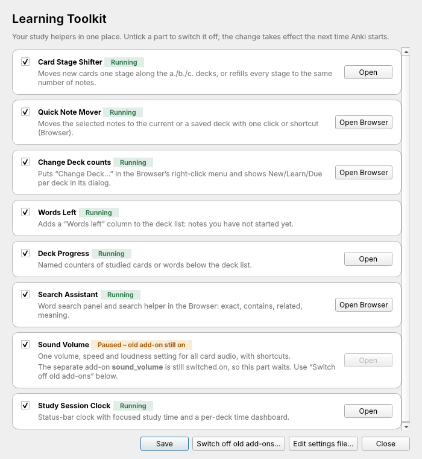
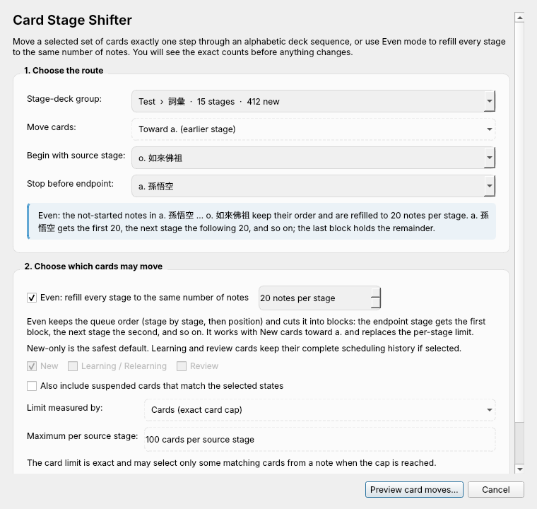
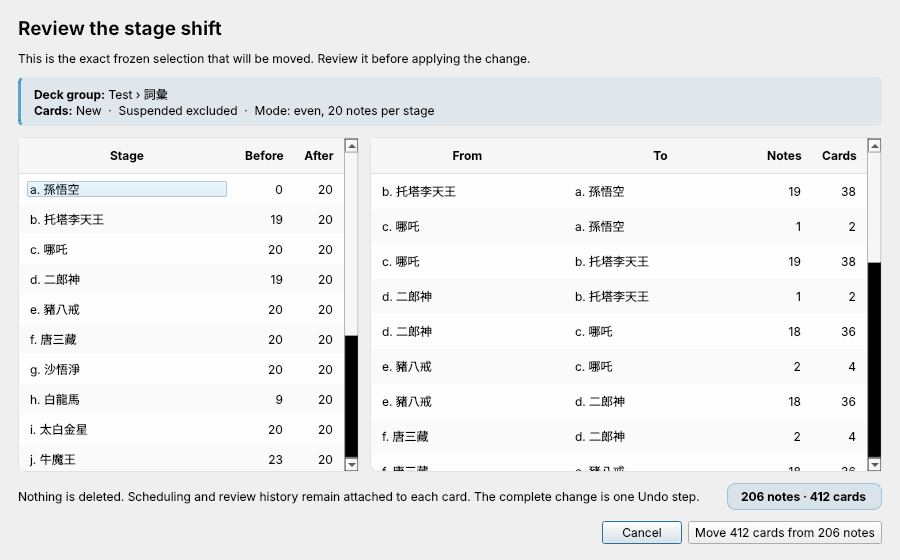
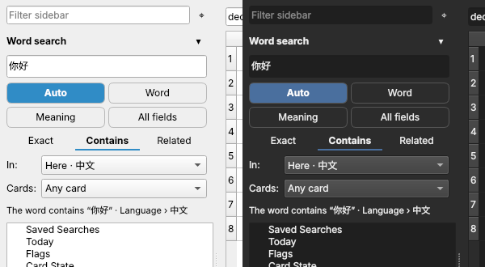
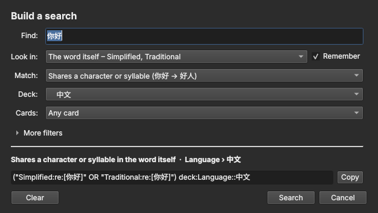
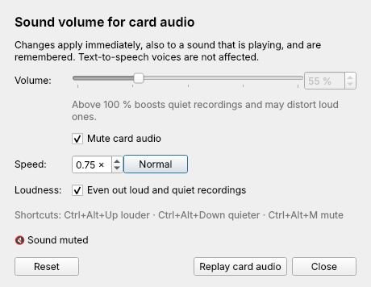
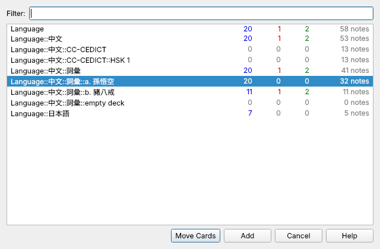
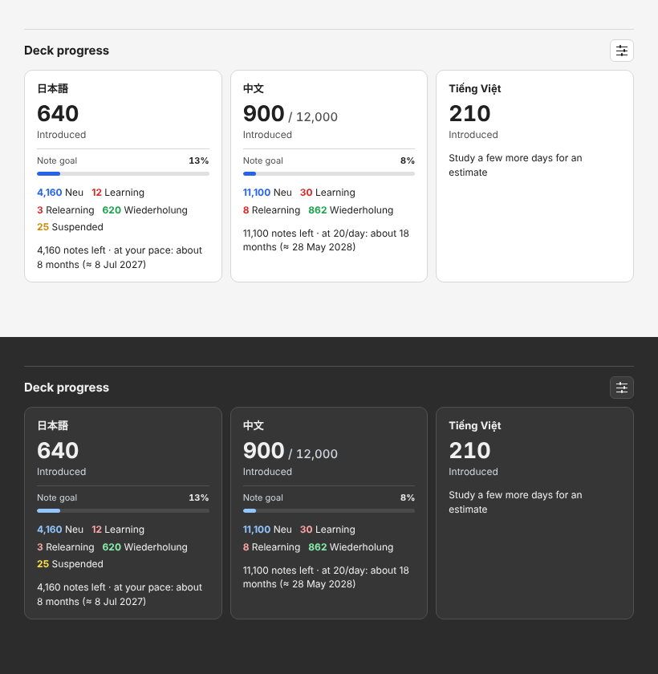

# Learning Toolkit for Anki

Eight small study helpers that used to be separate add-ons, merged into one add-on with one
menu, one settings file and one place to switch parts on and off.



| Part | What it does | Where you find it |
|---|---|---|
| **Card Stage Shifter** | Moves new cards one stage along `a.` / `b.` / `c.` sibling decks, or refills every stage to the same number of notes (*Even* mode). Shows the exact moves before anything changes and rolls everything back if a step fails. | Tools › Learning Toolkit › Card Organization › Card Stage Shifter… |
| **Quick Note Mover** | Moves the selected notes to the current deck or to a saved target deck with one click or a shortcut. | Browser › Notes › Quick Note Move |
| **Change Deck counts** | Adds “Change Deck…” to the Browser's right-click menu and shows New / Learn / Due and note counts per deck in that dialog. | Browser right-click menu |
| **Words Left** | Adds a “Words left” column to the deck list: notes you have not started yet. | Deck list |
| **Deck Progress** | Named counters below the deck list: studied words, goal and progress bar, optional card and note states (New, Learning, Review …) and an estimate of when you will be done ([formulas](docs/deck-progress-estimate.md)). | Tools › Learning Toolkit › Deck Progress… |
| **Search Assistant** | Word search in the Browser sidebar: results appear while you type, *Auto* picks the right fields (characters → the word, Latin text → word or meaning), and it searches the deck you are in. The normal search bar can use the same Auto mode. Read-only. | Browser sidebar, Browser › Search… |
| **Sound Volume** | One volume, speed and loudness setting for all card audio, adjustable while you study. | Tools › Learning Toolkit › Sound Volume…, `Ctrl+Alt+Up/Down/M` |
| **Study Session Clock** | Status-bar clock with focused study time and a per-deck time dashboard. | Status bar, Tools › Learning Toolkit › Study Clock |

## Install

1. Download `learning_toolkit-<version>.ankiaddon` from the newest `toolkit-v…` release in
   [Releases](../../releases) and double-click it (or *Tools › Add-ons › Install from file…*).
2. Restart Anki.

Requires Anki 25.02 or newer.

**Only want one part?** Every part is also released on its own (e.g. `deck_progress-1.7.0.ankiaddon`), and
older versions stay downloadable. How versions, upgrading and downgrading work: [docs/versions.md](docs/versions.md).
What changed: [docs/changelog.md](docs/changelog.md).

### Coming from the separate add-ons

The toolkit replaces these add-ons: `new_card_stage_shifter`, `note_stage_mover`,
`change_deck_counts`, `words_left`, `deck_progress`, `simple_search_assistant`,
`sound_volume`, `study_session_clock`.

- Installing the toolkit switches the old ones off (Anki's *conflicts* mechanism). Nothing is deleted.
- On the first start the toolkit copies your saved settings from the old add-ons (once).
- If an old add-on is still switched on, the matching part of the toolkit waits and the hub
  shows *Paused – old add-on still on*. **Switch off old add-ons…** in the hub does it for you.
- After a restart you can remove the old add-ons in *Tools › Add-ons*.

## Settings

*Tools › Learning Toolkit › Overview & settings…* (or *Config* in the add-on list) opens the hub. Untick a part to switch it off
(takes effect after a restart). **Edit settings file…** shows the raw settings: one section per
part (`"sound"`, `"search"`, …) plus `"modules"`. Only values you changed are saved, so a newer
version can still improve the defaults you never touched.

The original documentation of each part is kept in [`docs/legacy/`](docs/legacy/).

## Screenshots

| | |
|---|---|
|  |  |
| Card Stage Shifter – Even mode | The preview lists every move before anything changes |
|  |  |
| Word search in light and dark mode | Search dialog – the Anki query is written for you |
|  |  |
| Sound volume | Change Deck with counts per deck |



Deck Progress with card states and finish estimate (light and dark mode).

## Development

```
pip install anki aqt pytest
QT_QPA_PLATFORM=offscreen python -m pytest tests
python tools/package.py          # → dist/learning_toolkit-<version>.ankiaddon
python tools/package.py --all    # + every part as its own add-on (versions: tools/versions.json)
```

- `tests/test_toolkit.py` loads the whole toolkit into an offscreen main window with Anki's real
  add-on manager (module loading, settings sections, migration, old add-on guard).
- `tests/legacy/` holds the test scripts of the eight former add-ons, run against the toolkit
  modules. Several compare the core logic with the last stand-alone release; point
  `LT_OLD_ADDONS` at a folder with those releases (`<repo>/source/core.py`) to run them.

### Layout

```
learning_toolkit/
  __init__.py        loads each enabled part; one failing part never stops the others
  hub.py             the settings / overview dialog
  common/            settings sections, shared menu, old add-on detection and migration
  stage_shifter/ note_mover/ change_deck/ words_left/
  deck_progress/ search/ sound/ study_clock/
```

## License

Personal project, no license granted. Third-party code keeps its own notices.
